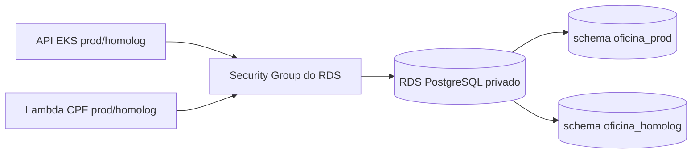

# Oficina Database Infra

Banco PostgreSQL da Oficina. O Compose da raiz é desenvolvimento local; `aws/` contém o Terraform de RDS PostgreSQL privado para Fase 3, ainda não aplicado. As migrations Flyway pertencem à aplicação.

```bash
cp .env.example .env
# defina POSTGRES_PASSWORD
docker compose up -d
```

## RDS na AWS Academy

Depois de provisionar a VPC/EKS no repositório Kubernetes, forneça ao módulo `aws/` os outputs `vpc_id`, `private_subnet_ids` e `cluster_security_group_id` como variáveis `TF_VAR_vpc_id`, `TF_VAR_private_subnet_ids` e `TF_VAR_eks_security_group_id`. Forneça `TF_VAR_db_password` somente pelo ambiente local seguro (mínimo 16 caracteres); não use `-var` com senha no histórico do shell nem grave `terraform.tfvars` no Git. `terraform init -backend=false`, `terraform fmt -check` e `terraform validate` funcionam sem state. `terraform plan` requer backend S3 inicializado e outputs reais do EKS, por isso aguarda a janela autorizada; `terraform apply` **não foi executado**.

O módulo cria subnet group privado em duas AZs, RDS Single-AZ `db.t3.micro` com 20 GiB gp2, criptografia, SG que aceita PostgreSQL somente do SG do EKS e do SG reservado à Lambda, e senha sensível. Homologação e produção usam schemas `oficina_homolog` e `oficina_prod`, criados por Flyway no primeiro deploy da API. A senha constará do state: configure antes do apply o backend S3 criptografado, privado e versionado; o workflow cloud usa `TF_STATE_BUCKET` e fica desativado sem `ENABLE_CLOUD_DEPLOY=true`. `skip_final_snapshot=true` facilita limpeza do laboratório, mas **perde os dados** no destroy: faça backup/exportação se precisar preservá-los. Verifique preço e permissão do Learner Lab antes de aplicar. Os outputs `db_endpoint` e `lambda_security_group_id` alimentam API e Lambda. Nenhuma rota pública de banco é criada.



Tecnologias: PostgreSQL 15, Amazon RDS, Terraform, Docker Compose local e Flyway na aplicação. Não há Swagger neste repositório: o banco não é uma API HTTP. O contrato de consumo está na [collection Postman da aplicação](https://github.com/ElizeuVicente/fiap-tech-challenge/blob/main/postman/oficina-fase3.postman_collection.json); veja também o [modelo relacional](https://github.com/ElizeuVicente/fiap-tech-challenge/blob/main/architecture/modelo-relacional.md).
